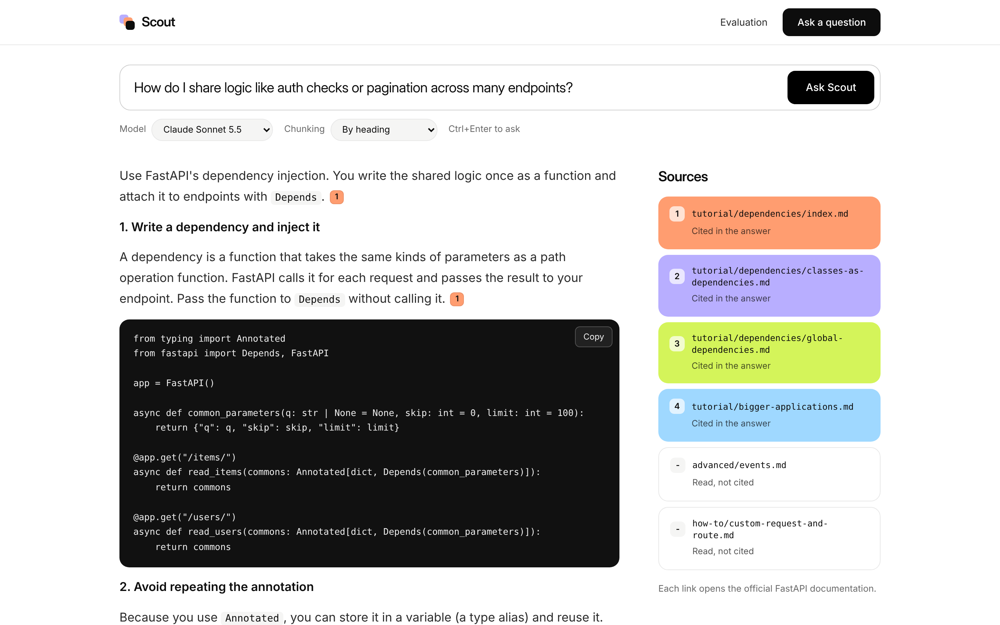
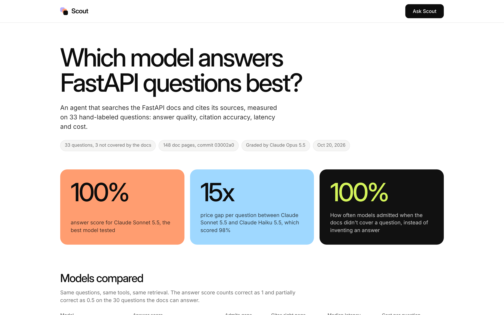

# Scout

Scout answers questions about the FastAPI documentation. An agent searches the docs, reads the pages it needs, and numbers every source it uses in the answer. The repo also includes an evaluation that compares models on answer quality, citation accuracy, latency and cost.



## How it works

The agent has three tools: `search_docs`, `read_page` and `list_pages`. It calls them in a loop until it can answer. Each run has a step limit and a token budget, and a failed tool call goes back to the model as text so it can try something else. Long pages are read in pieces with an offset. An optional `run_python` tool lets the agent check a snippet. It is off by default.

Retrieval is BM25 written from scratch over chunks of the docs, in under 100 lines. The model providers call the Claude API and Ollama over plain HTTP, so the same harness runs a hosted model or a local one.

## Run it

You need Python 3.10 or newer.

```bash
pip install -r requirements.txt
python scripts/fetch_corpus.py          # downloads the docs at a pinned commit
export ANTHROPIC_API_KEY=...            # or start Ollama for local models
python run.py                           # http://localhost:8000
```

The tests need no key and no network:

```bash
python -m unittest discover -s tests -t .
```

## Evaluation

`evals/questions.jsonl` has 33 questions. Thirty are answered by the docs, each with the page that contains the answer and a short reference answer. Three are not covered (rate limiting, a default body size limit, gRPC), to check whether a model admits the gap or invents an answer. Claude Opus 5.5 grades each answer against the reference.



| Model | Answer score | Admits gaps | Cites right page | Median latency | Cost per question |
|---|---|---|---|---|---|
| Claude Sonnet 5.5 | 100% | 100% | 100% | 9.2s | $0.0255 |
| Claude Haiku 5.5 | 98% | 100% | 100% | 7.3s | $0.0017 |
| llama3.1 8B (local) | 18% | 0% | 3% | 19.2s | free |

Haiku comes within two points of Sonnet at about a fifteenth of the price. The local 8B model mostly fails by inventing tool results instead of calling the tools.

The first run found three problems: pages were cut off at 6,000 characters, some runs used every step searching without answering, and the judge could not see the docs. After fixing them, the judge was also shown the pages each answer cited, which removed penalties for correct claims taken from other real pages. Part of the final gain comes from that grading fix and not from the agent.

### Retrieval only

`python evals/retrieval_eval.py` needs no API key. A question counts as a hit at k when one of its expected pages is in the top k.

| Chunking | Chunks | Hit@1 | Hit@3 | Hit@5 | MRR |
|---|---|---|---|---|---|
| Fixed (200 words) | 695 | 57% | 77% | 87% | 0.69 |
| Headings | 1,142 | 63% | 80% | 93% | 0.75 |

Splitting on headings does better at every depth, and it puts the section title into the indexed text. Both strategies miss questions phrased in words the page never uses, like "turn off the interactive docs" for a page about conditional OpenAPI. A keyword index cannot bridge that gap, and embeddings would be the next thing to try.

### Run your own

```bash
python evals/run_eval.py --models anthropic:claude-haiku-5-5 anthropic:claude-sonnet-5-5
python evals/run_eval.py --models ollama:llama3.1 --judge anthropic:claude-sonnet-5-5
python evals/report.py                  # builds results/report.html
```

`--max-cost` stops a run if spending passes a limit. `evals/regrade.py` re-grades saved answers without calling the candidate models again.

## Limits

- I wrote the questions and reference answers from the docs, and nobody else has reviewed them. A score this close to 100% on 33 questions means the set is nearly saturated. A harder set is the next step.
- The judge is an LLM and favors answers written by its own model family. Read the reasons saved in the JSON output.
- Retrieval is lexical only, so it cannot match a question that shares no words with the right page.
- `run_python` is not a sandbox. It runs in a separate process with a timeout and a stripped environment, but the code runs as you. Leave it off unless you are on a machine you control.
- The web app has a per-client rate limit and no login, and it spends your API key on every question. Run it on localhost.
- Cost numbers use the prices in `scout/pricing.py`, checked on 2026-10-20. Check them before quoting.

## Layout

```
scout/        chunking, BM25 retrieval, tools, model providers, agent loop, pricing
evals/        question set, retrieval eval, model eval, regrade, report
tests/        unit tests that run offline with a fake model
app.py        FastAPI app, frontend/ has the page
```

The docs in `data/` come from [fastapi/fastapi](https://github.com/fastapi/fastapi) (MIT licensed) and are downloaded, not stored in this repo.
